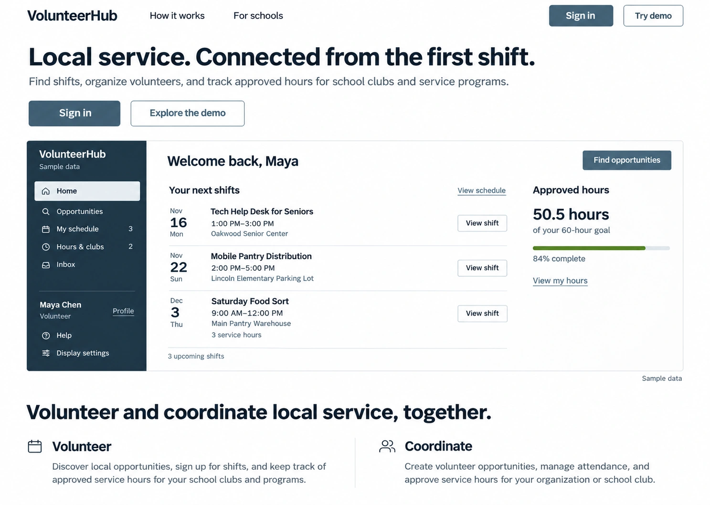
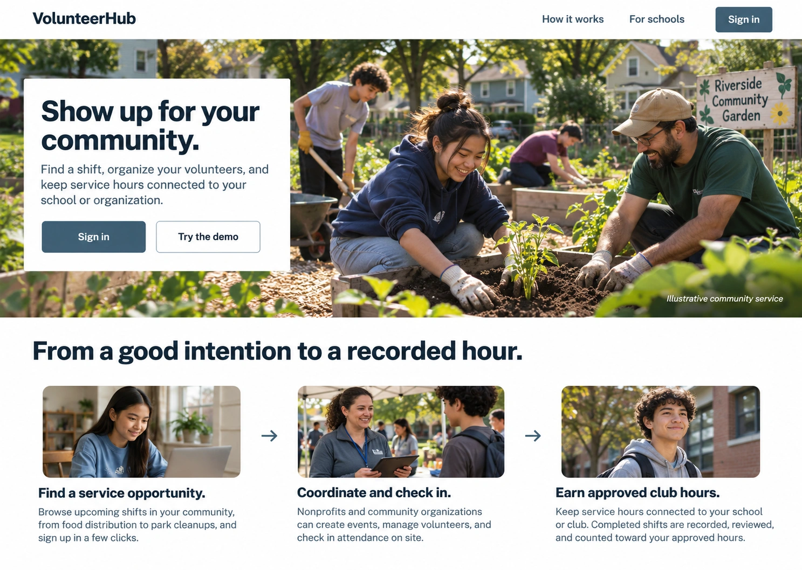
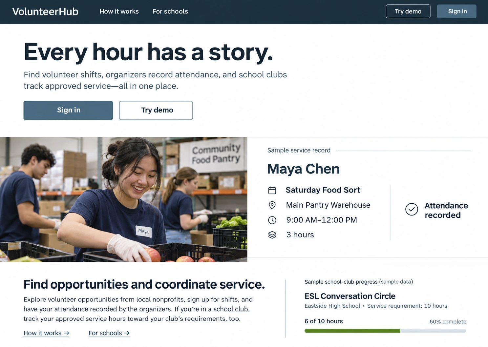

# VolunteerHub public landing previews

These are the original design proposals for the page visitors see **before signing in**. The owner selected proposal 2 with the restraint of proposal 3, one hero photo, purposeful copy and serif-led public typography. See [the implementation and screenshots](PUBLIC_LANDING.md).

The owner confirmed that sign-in should have primary emphasis, with a visible demo option for presenting to judges. All proposals keep both school and nonprofit workflows in the story; implementation will retain the volunteer and coordinator demos, signup and password reset.

## 1. See the service in motion

A broad product preview shows what the site does before asking visitors to sign in. It is the most direct introduction to the software; the preview needs care to keep the public page feeling like a website.

## 2. Show up for your community

**Recommended.** A community-service image makes the human purpose immediately visible. Sign-in and demo actions lead into a practical explanation of discovery, attendance and approved club hours.

## 3. Every hour has a story

A service activity and a sample attendance record connect volunteering to its recorded hours. This makes the school-service connection especially clear; the supporting sections need to explain opportunity discovery equally well.

## Research and implementation plan

Rendered desktop references were reviewed on November 15, 2026:

- [GivePulse](https://learn.givepulse.com/) uses community imagery and distinguishes involvement from organization needs. VolunteerHub can use human context while keeping the explanation and action immediately visible.
- [Mobilize](https://www.mobilize.us/) makes opportunities concrete through actual event content and attendee/organizer paths. VolunteerHub can use specific examples with a simpler first view.
- [Notion Calendar](https://www.notion.com/product/calendar) places a clear explanation and deliberate actions before a product reveal. VolunteerHub can use that clarity within its own website identity.

The selected proposal will be implemented as a responsive public page, followed by substantive sections for volunteers, coordinators and school clubs, clear demo access and a compact footer. Sign-in remains a focused task with the existing account behavior. Keyboard navigation, visible focus, browser history, mobile layouts at 320/768/1024/1440px, enlarged text, light/dark themes and reduced motion will be checked.

All proposal photography is generated illustrative material, not evidence of real volunteers, organizations or customers. All shown records are examples. UI wording and sample-data consistency remain implementation responsibilities. Final images will be produced separately from these comps; no screenshot will replace working text or controls.

The three compositions inherit the current Public Sans, navy/white palette and small control shapes. No backend migration, paid service, new framework or global design-system replacement is planned.

The selected proposal's sidecar records the owner's approval and changes. These images remain historical design proposals; current behavior is documented in the implementation guide. The owner will replace the single placeholder photo with their own.
