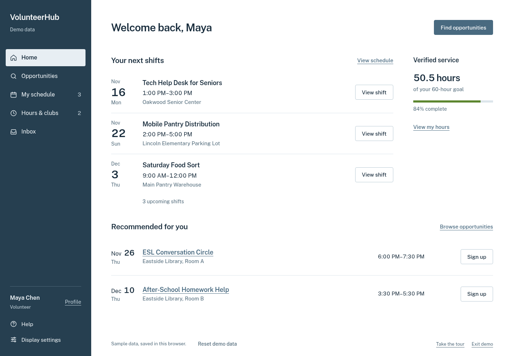

# Open agenda website

The owner selected **Open agenda** after reviewing the two visual proposals and confirmed that VolunteerHub should look and behave like a website. This branch applies that direction to the volunteer and coordinator pages, login and signup, forms, dialogs, and display preferences.



## What changed

- A consistent dark blue sidebar, white reading surface, restrained slate-blue actions and locally served Public Sans.
- Home follows the selected proposal: equally weighted dated shifts, a quieter service-hours column, and full-width recommendations.
- Page navigation and section tabs use real links. Browser Back, Forward, refresh, direct page URLs and opening links in a new tab retain the selected page and its role restrictions.
- Profile and Help are direct links. Display settings expand inline. Tour and sign-out actions sit in the website footer, leaving the mobile header simpler.
- Pages scroll naturally. Mobile navigation wraps so every destination remains visible; wide tables scroll inside their section.
- Clear action labels, visible focus, light/dark themes, enlarged text, high contrast, and semantic red → yellow → green progress remain available.
- Form boundaries have stronger contrast. Tutorial and signup messages now match the current interface and city-based discovery.

[Opportunities](open-agenda/opportunities.png) · [Hours](open-agenda/hours.png) · [Coordinator overview](open-agenda/coordinator.png) · [Phone](open-agenda/mobile-home.png)

## Try it

Fetch and switch to `codex/open-agenda-website`. From the repository root, run:

```sh
python -m http.server 4173 --directory volunteerhub-web/vh-web
```

Open `http://localhost:4173`, then use Maya's volunteer demo or the coordinator demo. The branch's public GitHub Pages URL is not a preview deployment; inspect the code locally or use the images above.

## Verification

The isolated suite passes 38 checks, including the existing account, discovery, history, club approval, attendance, Inbox and CSV workflows. Additional checks cover Back/Forward/refresh, new tabs, direct URL permissions, inline preferences, dialog focus, locally served fonts and empty-state recovery.

Responsive checks cover 320, 390, 768, 1024, 1415 and 1440px, including enlarged text and high contrast. Axe scans cover account forms and both roles in light/dark themes, plus expanded display preferences and event dialogs. Browser checks replace the Firebase configuration and use fictional sample data; they do not write production records or establish production load capacity.

The vanilla HTML/CSS/JavaScript stack, Firebase account/data behavior and Firestore rules are preserved. This adds no paid service, external font request, native-app framework or UI image dependency. Public Sans remains bundled with its OFL license.

The selected visual reference remains [the original Open agenda sketch](../.impeccable/mocks/decision/open-agenda.html). The earlier [proposal comparison](VISUAL_PREVIEW.md) is retained as historical design context.
