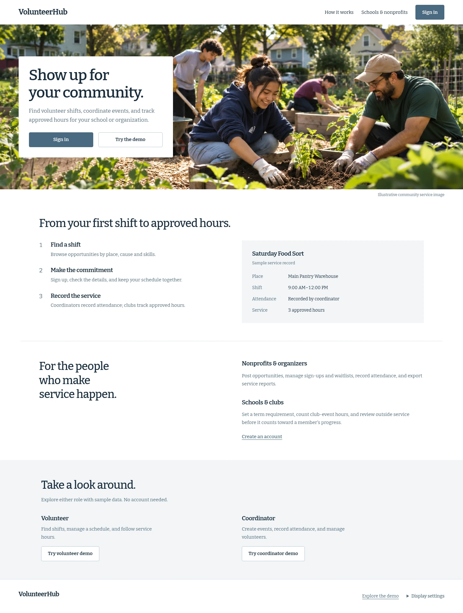

# VolunteerHub public landing page

The public entry page now uses the selected community-led composition with the owner's requested restraint: one large photo, serif typography, concise explanations and a sample service record. Sign-in is primary; both demo roles remain available without creating an account.



[Phone layout](public-landing/mobile.webp) · [Sign-in page](public-landing/sign-in.webp) · [Original proposals and research](LANDING_PREVIEW.md)

## What changed

- A single service image introduces the purpose. Below it, a short process explanation and an explicitly labeled sample record connect opportunities, attendance and approved hours.
- Bitter replaces the public page's sans-serif treatment. The font is served locally with its Open Font License. Signed-in screens retain the selected Open agenda system.
- The public page, sign-in, signup and password reset use ordinary website links, browser history and meaningful page titles. Protected links still require an account, and role permissions remain enforced.
- The existing volunteer and coordinator demo handlers, location-optional signup and password reset are preserved. Live forms wait for their connection before allowing submission.
- Narrow layouts put the photo above the introduction. Large text, light/dark themes, high contrast, skip navigation, visible focus and image-failure recovery remain usable.

## Replace the placeholder photo

The current generated garden image is a **temporary placeholder**, as confirmed by the owner. Only one photo is needed.

Replace [`community-garden.webp`](../volunteerhub-web/vh-web/images/community-garden.webp) with your team's image, or update its `src` in [`landing.js`](../volunteerhub-web/vh-web/js/views/landing.js). A wide image around 2200px across works well; keep the main subjects toward the right and leave space at the left for the desktop introduction. Phones use a tighter crop.

Update the image's `alt` text and the “Illustrative community service image” caption to describe the replacement accurately. Update the neighboring `.webp.json` provenance file with the new image's source rather than retaining the generated placeholder's prompt. Recheck the photo at phone and desktop widths.

## Run this branch

```sh
git fetch origin
git switch codex/public-landing-redesign
python -m http.server 4173 --directory volunteerhub-web/vh-web
```

Visit `http://localhost:4173` in a fresh browser context for the public entry. An existing signed-in session continues to its account. `/#login` and `/#signup` also open the account pages when signed out.

The GitHub Pages live site is a separate deployment; this branch does not change it.

## Verification

The 43-check suite passes with fictional sample data and mocked Firebase configuration. It covers the existing volunteer/coordinator workflows plus public browser history, refresh/new tabs, keyboard sign-in and error recovery, both demo roles, connection/reset behavior, 320/390/768/1024/1440px layouts, enlarged text, missing-image recovery and axe scans in both themes. See [test instructions](../tests/README.md).

Screenshots additionally cover the original comp's 1487px viewport, expanded display settings, signup validation, dark mode and high contrast. These checks do not establish production database load capacity or deployment readiness.

The separate visual review found no material page/UI issue in the 17 supplied captures. Its subsequent narrow verdict resolved the two persistence findings through the design-record merge and truthful workflow disclosure; it does not certify automated completion.

The Impeccable comp-first preview choice and the owner's modifications are recorded in the [surface brief](../.impeccable/surfaces/volunteerhub-web-vh-web-js-views-landing-js.md). Its automated font-matching step reports no resolvable browser/catalog, so the automated pipeline remains open at SPEC. Direct Chromium verification and the separate visual review are distinct from that unclosed workflow; no asset-review acceptance or automated gate pass is claimed.

No backend, Firestore rules, build framework or paid service was added or migrated.
