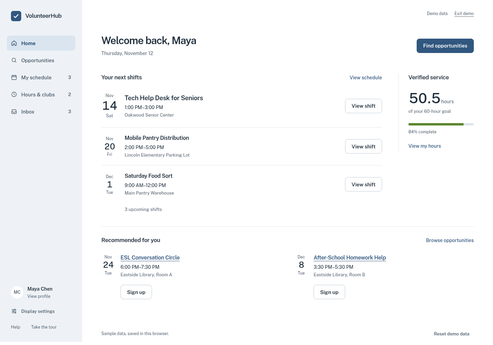
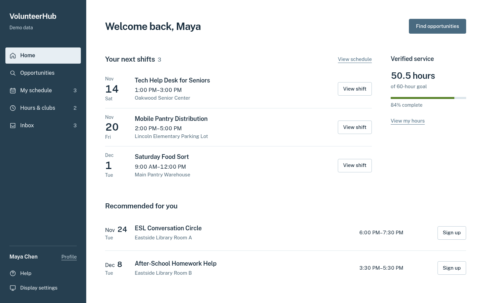

# VolunteerHub visual proposals

This branch contains two proposed visual directions and **one working Home preview**. The owner has not approved a site-wide direction. Other screens retain the interface from `codex/interface-cleanup`.

## Clear workspace — working preview

The light blue-grey sidebar keeps navigation quiet. The next shift receives stronger type and date hierarchy; verified service sits alongside the schedule; recommendations follow below. Public Sans replaces the earlier technical-looking typography on this screen. Actions state their purpose: **View shift**, **Find opportunities**, **View my hours**, and **Sign up**.

Profile is a direct destination. Display preferences expand inline, with explicit theme, text-size and contrast controls. There is no account dropdown on this Home screen. The preview includes restrained light and dark palettes; progress retains red → yellow → green semantics without a neon green.

[Phone preview](visual-preview/clear-workspace-mobile.png) · [Dark-theme preview](visual-preview/clear-workspace-dark.png) · [Static first-viewport sketch](../.impeccable/mocks/decision/clear-workspace.html)

## Open agenda — alternate visual proposal

A dark blue sidebar provides a stronger edge. Three equal-weight dated shifts form a wider agenda; verified hours stay quieter; recommendations use full-width rows. It uses the same readable font family with a denser, more date-led composition.

[Open the static sketch](../.impeccable/mocks/decision/open-agenda.html). It is a visual proposal with intentionally inactive controls. Only Clear workspace is integrated with the real app handlers.

## Try the working screen

1. Fetch and switch to `codex/visual-redesign-preview`.
2. Open `volunteerhub-web/vh-web/index.html` with your existing local preview workflow. For an HTTP server, run `python -m http.server 4173 --directory volunteerhub-web/vh-web` from the repository root, then visit `http://localhost:4173`.
3. Use the sample volunteer account **Maya Chen** and open **Home**. Skip the tour if you want to judge the resting screen first.
4. Try View shift, Sign up, profile access, Display settings, and navigation to the existing screens. Demo actions use sample data.

The Home styling is scoped by `body.home-preview`; leaving the volunteer dashboard restores the other screens' existing styles. No authentication provider, database rules or synchronization code was changed. Public Sans is served locally with its OFL license; this preview adds no paid service or new runtime framework.

## Reference study

| Official reference | Useful observation | Excluded from VolunteerHub |
| --- | --- | --- |
| [Things](https://culturedcode.com/things/) | Section spacing, readable headings, a quieter sidebar, subordinate metadata | Branded pictograms, native-app window chrome, proprietary content |
| [Todoist](https://www.todoist.com/features) | Obvious current navigation, legible task rows, hierarchy without individual cards | Branding, emojis, its account-menu density and red palette |
| [Google Calendar](https://workspace.google.com/products/calendar/) | Date/time ordering and explicit event actions | Dense week grids, multicolour fields, floating marketing callouts and glow |

The owner supplied [SignUpGenius](https://www.signupgenius.com/) as an anti-reference for clutter. No third-party reference image ships in the app.

## Verification and review boundary

The isolated test suite passes 34 checks. The Home-specific checks cover descriptive actions, existing event IDs, signup updates, dialog focus after redraws, complete city-level distance labels, keyboard-operated inline preferences, direct profile/help access, empty-state recovery, local font loading, and styling scope. Responsive checks cover 320, 390, 768, 1024, 1415 and 1440px, including enlarged text/high contrast and all five navigation destinations visible without horizontal scrolling. Axe scans cover Home, expanded preferences and event dialogs in light and dark themes. Existing account, discovery, club, attendance, Inbox and export checks continue to pass.

Browser checks stub the Firebase configuration and use sample data. They do not establish production Firebase readiness or load-test capacity. Visual preference remains the owner's decision: review the two proposals and the working Home screen before extending either direction.
